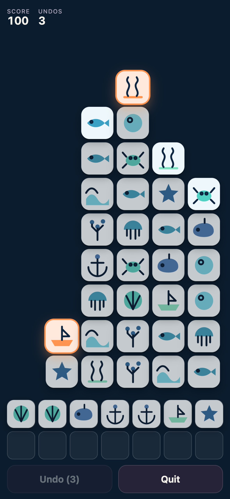
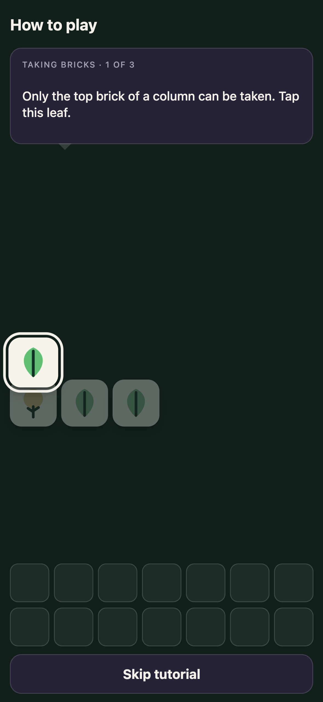
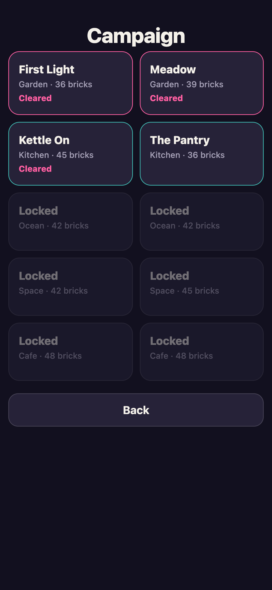

# Stacked Match

A calm, colourful stacked brick matching puzzle for the phone. Take the top
brick of a column, gather three of a kind, and never let the tray fill up.

**[Play it →](https://markwylde.com/stacked-match/)**

| Gameplay | Learning it | Campaign |
| --- | --- | --- |
|  |  |  |

## How it plays

Three rules, and none of them are guessable from looking at the board, which is
why the game teaches them by hand before the first level:

1. **Only the top brick of a column can be taken.** Everything is visible —
   nothing is hidden, face-down, or occluded. No cheap deaths.
2. **Three of a kind clears**, not two. Bricks you take sit in the tray until
   they find their pair.
3. **The tray never empties on its own.** Fourteen slots, and only a match
   frees them. Fill every slot with no match and the run ends.

There is **no clock**. You can stare at the board for as long as you like. The
pressure is a strategic squeeze rather than an adrenal one, which is the whole
point: relaxing, with a real decision in it.

### The colour wash

Clearing a set washes whatever bricks it just uncovered — they glow in the
level's accent colour. Take a washed brick and you start a chain; take another
and the chain grows, and so does the bonus. Take an unwashed brick and it
breaks. The board visibly ripples after every match, and reading it in runs
rather than single taps is where the points are.

### Two modes

**Campaign** — ten hand-authored levels across five themes. Each level is a
deliberate silhouette, and clearing every brick wins it. Difficulty rises
through the number of icon types competing for the same fourteen slots.

**Endless** — a new row rises from the floor every third set you clear. Progress
and danger are the same action. The run ends when the tray jams or a column
reaches the ceiling.

## Install it

It is a PWA. Open it on a phone and add it to your home screen: it launches
standalone in portrait, and once installed it is fully playable offline —
every theme's artwork is precached up front, so a level you have never reached
still renders with no connection.

Updates never interrupt a run. A new version waits until you are back at a menu
before it swaps itself in.

## Development

```bash
npm install
npm run dev          # dev server, no service worker
npm test             # 267 tests
npm run build        # production build
npm run preview      # serve the build
```

Other scripts worth knowing:

| Script | What it does |
| --- | --- |
| `npm run typecheck` | Strict TypeScript, no emit |
| `npm run lint:boundary` | Fails if anything in `src/core` touches the DOM |
| `npm run verify:pwa` | Checks the built manifest, icons and precache manifest |
| `npm run sheet` | Writes `docs/icon-sheet.html` — all 75 icons at real brick size |
| `npm run icons` | Regenerates the app icon set |
| `npm run shot` | Recaptures the screenshots above from the built app |

## How it is built

TypeScript and Vite. No game engine, no UI framework, nothing in the shipped
bundle but the game.

```
src/core     pure rules - board, tray, colour wash, scoring, undo, lessons
src/shell    DOM rendering, input, animation, service worker, tutorial gate
src/themes   icon artwork and palettes
src/content  campaign levels and tutorial lessons, as data
```

The split is enforced, not just intended: `npm run lint:boundary` fails the
build if anything under `src/core` so much as mentions `document`. Every rule is
therefore a plain function, testable without a browser, and the shell can never
quietly grow a rule of its own.

Bricks are real `<button>` elements in one absolutely-positioned layer, so a
brick flying from the board to the tray is a single transform change, and
keyboard and screen-reader support come from the platform rather than being
reimplemented. Positions are computed from game state and never measured from a
node that might be mid-flight, which is what lets an interrupted animation
re-target instead of queueing.

### Two decisions worth knowing about

**The tray holds fourteen, not the genre-standard seven.** Only one brick per
column is ever free, so a player can never hunt across the board for a match the
way a layered tile game allows. A seven-slot tray is not merely hard, it is
unwinnable — a simulated player cleared 0% of boards at seven slots, 10% at ten,
and 53% at fourteen. The size was measured, not inherited.

**Every level and every lesson is verified by playing it.** A test harness plays
each campaign board to a win and each tutorial lesson step by step through the
real rules, asserting that every outcome a caption promises actually happens.
Board generation guarantees no orphaned bricks; the harness guarantees the
boards are winnable in practice — a distinction that cost a full rewrite to
learn.

## Accessibility

Every icon is identifiable by outline alone, so colour is never the only signal.
Bricks are keyboard reachable, blocked bricks are skipped in the tab order, and
each announces its icon, its column, and whether it is washed. `prefers-reduced-motion`
replaces travel animation with fades while keeping every state change legible.

## Credits

All 75 icons are original artwork, defined as SVG path data in
`src/themes/icons.ts`. See [docs/ASSETS.md](docs/ASSETS.md).
